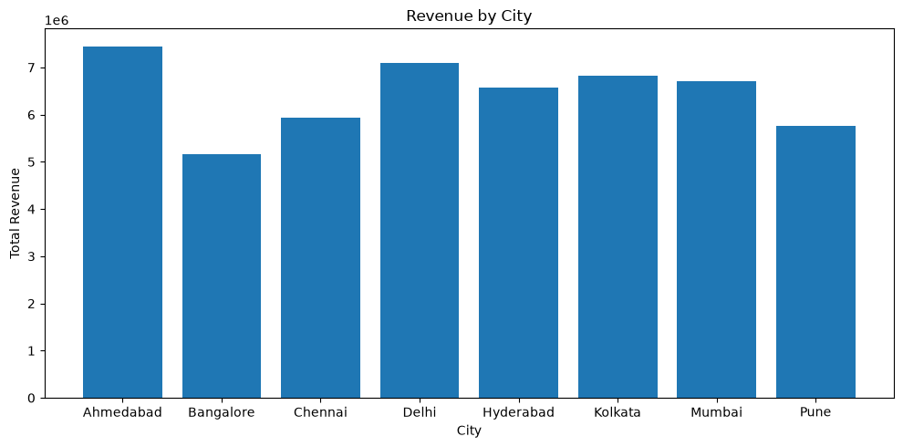
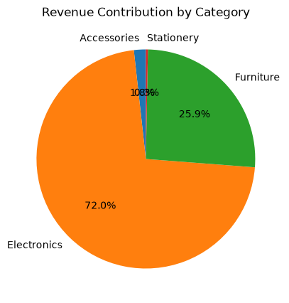
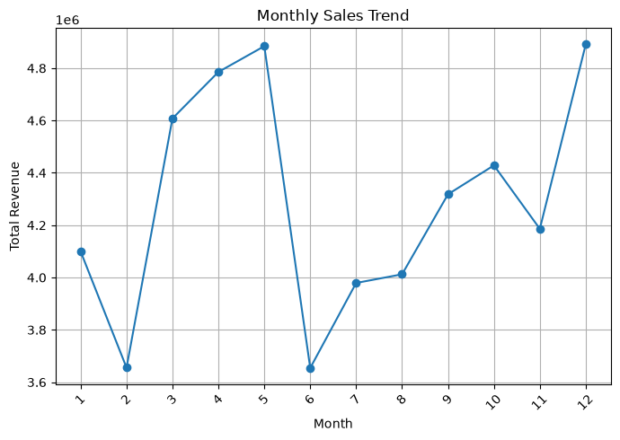

# 🛒 Online Store Sales Data Analytics

## 📌 Project Overview

This project focuses on analyzing online store sales data to understand sales performance, identify top-selling products, analyze city-wise revenue, and discover monthly sales trends.

The project uses Python, Pandas, Matplotlib, and MySQL to clean, analyze, and visualize sales data. It also applies a simple Moving Average method to forecast future sales.

The main goal is to transform raw sales data into meaningful business insights that can support better business decisions.

## 🔗 Project Link

- **GitHub Repository:** [Add Your GitHub Repository URL]
- **Project Demo:** Not available

## 📑 Table of Contents

1. Business Understanding
2. Data Understanding
3. Data Cleaning and Preparation
4. Exploratory Data Analysis
5. Screenshots of Visualizations
6. Sales Forecasting
7. Business Insights
8. Business Recommendations
9. Technologies Used
10. Project Setup
11. Project Approach
12. Project Status
13. Credits

---

## 1. 🎯 Business Understanding

### Problem Statement

Online stores generate large amounts of sales data. Analyzing this data helps businesses understand product performance, customer purchasing patterns, revenue generation, and sales trends.

This project analyzes an online store sales dataset to identify important business patterns and provide useful recommendations for improving sales performance.

### Project Objectives

- Calculate total sales revenue.
- Identify the best-selling product based on quantity sold.
- Analyze city-wise revenue performance.
- Understand category-wise revenue contribution.
- Identify the top 3 products by revenue.
- Calculate the average quantity per order.
- Analyze monthly sales trends.
- Forecast future sales using a simple Moving Average method.
- Provide business recommendations based on the analysis.

---

## 2. 📊 Data Understanding

### Dataset Information

- **Dataset Name:** Online Store Sales Dataset
- **Total Records:** 2,000 rows
- **File Format:** Excel and CSV
- **Data Type:** Structured Sales Data

### Dataset Columns

| Column | Description |
|---|---|
| Order_ID | Unique order identification |
| Date | Date of the order |
| Product | Name of the purchased product |
| Category | Product category |
| Quantity | Number of items purchased |
| Price | Price of the product |
| City | Customer's city |
| Revenue | Calculated sales revenue |

---

## 3. 🧹 Data Cleaning and Preparation

Data cleaning was performed using Python and Pandas to prepare the dataset for analysis.

### Cleaning Steps

- Checked missing values in the dataset.
- Identified and removed duplicate records.
- Checked product, category, and city names for consistency.
- Converted the Date column into datetime format.
- Inspected negative and invalid price values.
- Handled missing values based on data inspection.
- Created a new Revenue column.

### Revenue Calculation

**Revenue = Quantity × Price**

The cleaned dataset was exported into CSV format for further analysis.

---

## 4. 📈 Exploratory Data Analysis (EDA)

Exploratory Data Analysis was performed to understand the sales performance of the online store.

### Analysis Performed

1. **Total Revenue Analysis:** Calculated the overall revenue generated by the store.
2. **Best-Selling Product:** Identified the product with the highest quantity sold.
3. **City-wise Revenue Analysis:** Compared revenue generated across different cities.
4. **Category-wise Revenue Analysis:** Analyzed revenue contribution from each category.
5. **Top 3 Products by Revenue:** Identified the three products generating the highest revenue.
6. **Average Quantity per Order:** Calculated the average number of items purchased per order.
7. **Monthly Sales Analysis:** Analyzed revenue changes over different months.

SQL queries using MySQL were also used to retrieve and analyze sales information.

---

## 5. 📸 Screenshots of Visualizations and Results

### 5.1 Revenue by City

This bar chart displays the total revenue generated by each city and helps identify the highest-performing city.



### 5.2 Revenue Contribution by Category

This pie chart displays the percentage contribution of each product category to the total revenue.



### 5.3 Monthly Sales Trend

This line chart shows the monthly revenue trend and helps understand changes in sales performance over time.



---

## 6. 🔮 Sales Forecasting

A simple Moving Average Forecasting method was used to estimate future sales.

### Forecasting Method

The average revenue of the previous three months was calculated to predict the next month's revenue.

**Formula:**

Predicted Sales = (Previous 3 Months Revenue) / 3

### Purpose

- Estimate future sales performance.
- Support inventory planning.
- Understand potential changes in revenue.
- Help businesses make basic sales decisions.

This method provides an estimated value and does not guarantee actual future sales.

---

## 7. 💡 Business Insights

The following insights were identified through the analysis:

1. **Overall Revenue:** Calculated the total revenue generated by the online store.
2. **Best-Selling Product:** Identified the product with the highest quantity sold.
3. **City Performance:** Compared revenue across cities to identify the highest-performing location.
4. **Top 3 Products:** Identified the three products generating the highest revenue.
5. **Average Quantity per Order:** Calculated the average number of items purchased in each order.

---

## 8. 📌 Business Recommendations

Based on the analysis, the following recommendations can help improve business performance:

1. **Maintain Stock:** Keep sufficient stock of best-selling products to meet customer demand.
2. **Improve City Sales:** Focus on cities with lower revenue through targeted promotions.
3. **Promote Top Products:** Give more attention to the top revenue-generating products.
4. **Offer Discounts:** Encourage customers to purchase more items through combo offers and discounts.
5. **Monitor Sales:** Regularly track monthly sales to understand performance and plan inventory requirements.

---

## 9. 🛠️ Technologies Used

| Technology | Purpose |
|---|---|
| Python | Data analysis and calculations |
| Pandas | Data cleaning and manipulation |
| Matplotlib | Data visualization |
| SQL (MySQL) | Database queries and sales analysis |
| Jupyter Notebook | Writing and executing Python code |
| VS Code | Development environment |
| Microsoft Excel | Dataset storage and inspection |
| GitHub | Project hosting and version control |

---

## 10. ⚙️ Project Setup

### Prerequisites

- Python installed on your system.
- Visual Studio Code or Jupyter Notebook.
- Required Python libraries.

### Step 1: Clone the Repository

```bash
git clone YOUR_GITHUB_REPOSITORY_URL
```

### Step 2: Navigate to the Project Folder

```bash
cd YOUR_PROJECT_FOLDER
```

### Step 3: Install Required Libraries

```bash
pip install pandas matplotlib openpyxl jupyter
```

### Step 4: Open Jupyter Notebook

```bash
jupyter notebook
```

### Step 5: Run the Project

Open `salesdata.ipynb` and execute the notebook cells in order.

Make sure the dataset files are available in the project folder.

---

## 11. 🔍 Project Approach

The project was completed through the following stages:

1. **Data Collection:** Loaded the online store sales dataset.
2. **Data Cleaning:** Checked and handled missing values, duplicates, and invalid data.
3. **Data Transformation:** Converted date values and calculated revenue.
4. **Data Analysis:** Used Pandas and SQL to analyze sales performance.
5. **Data Visualization:** Created charts using Matplotlib.
6. **Sales Forecasting:** Applied the three-month Moving Average method.
7. **Business Recommendations:** Suggested improvements based on the analysis.

---

## 12. 📌 Project Status

**Status: Completed**

The project includes data cleaning, exploratory data analysis, SQL-based analysis, data visualization, business insights, recommendations, and basic sales forecasting.

---

## 13. 🙏 Credits

This project was completed as part of my Data Analytics learning and internship project work.

Thank you for visiting my project!
